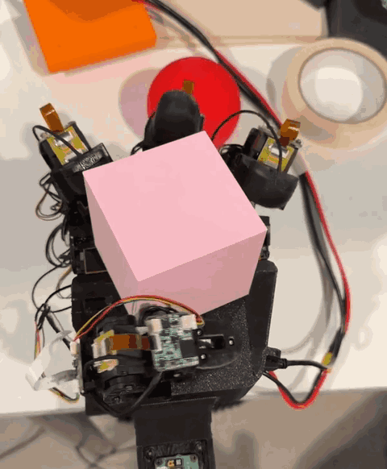
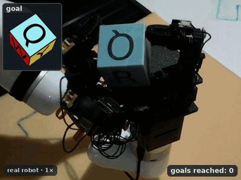
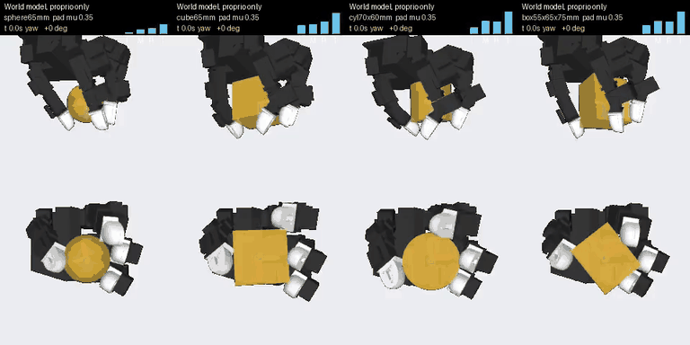
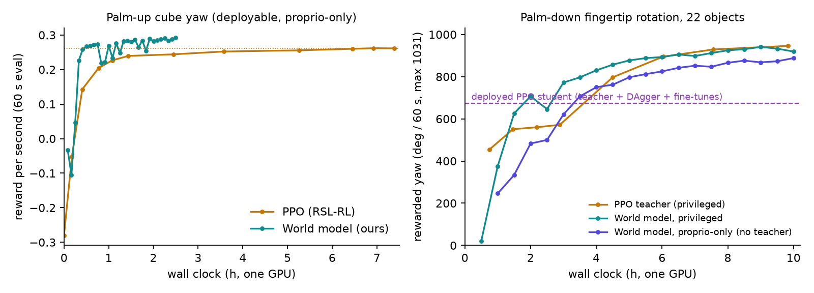

# In-Hand Rotation with the LEAP Hand in mjlab: PPO and World-Model RL

In-hand manipulation with the [LEAP Hand](https://leaphand.com/) in [mjlab](https://github.com/mujocolab/mjlab): cube **yaw rotation**, **SO(3) reorientation** and palm-down **fingertip rotation of 22 objects**. Every task trains with **PPO**, and the yaw and fingertip tasks also train with a **learned differentiable world model** in the style of [SuperMimic](https://supermimic.github.io/). The robot model includes a servo model identified on the real hand, and the trained checkpoints are included.

<table align="center">
  <tr>
    <td align="center" width="50%"><br/><em>Real robot: cube yaw rotation (PPO)</em></td>
    <td align="center" width="50%"><br/><em>Real robot: SO(3) reorientation, 6 cm cube, 4 goals in 18 s (PPO, the released checkpoint; inset = goal)</em></td>
  </tr>
</table>

<p align="center"><br/>
<em>Simulation: palm-down fingertip rotation by the world-model policy, which reads only the hand's joints (no object state, no touch). Pad friction 0.35, about the real PaXini pads'. Top: from below; bottom: looking up the palm normal.</em></p>

**v2 (this branch)** adds the SO(3) and fingertip tasks, the measured LEAP servo model, the world-model trainer and the released checkpoints. The original v1 release (yaw only, with its sim-to-real deployment code) is on the [`v1` branch](https://github.com/Msornerrrr/in-hand-rotation-mjlab/tree/v1). Full yaw deployment video and failure cases: [YouTube](https://www.youtube.com/watch?v=5JPbPGIz82w).

## What is here

| Task | What it does | PPO | World model | Real robot |
|---|---|---|---|---|
| **Cube yaw** (palm up) | turn a cube about the vertical axis, proprioception only | ✅ checkpoint | ✅ checkpoint | ✅ video above |
| **SO(3) reorientation** (5 / 6 / 7 cm cubes) | turn the cube to random goal orientations, with the cube pose from vision | ✅ checkpoints | — | ✅ video above |
| **Fingertip rotation** (palm down, 22 objects) | spheres, cubes, cylinders and cuboids of 6–7.5 cm on the fingertip pads only | ✅ teacher + deployed student | ✅ privileged + proprio-only | — |

All tasks run on the measured LEAP servo (current-limited Dynamixel position control, gearbox friction, 0.15 rad driver lead clamp, real link masses) with its randomization, so they train and evaluate on the plant the policies were deployed on.

## Results

<p align="center"></p>

Wall-clock times are on one RTX 4090.

**Cube yaw (palm up).** Evaluated over 60 s on 512 environments with the measured plant randomized.

| Policy | Reward / s | Yaw rate | Wall clock | Env steps |
|---|---|---|---|---|
| PPO | 0.261 | 0.344 rad/s | 7.4 h | 393M |
| World model | **0.292** | 0.335 rad/s | 2.5 h | 102M |

The world-model policy reached PPO's level (≈0.26 reward/s) after **25 minutes and 18M env steps**, where PPO needed 6.5 hours and 262M steps: about **15× faster** in both wall clock and samples. It passed PPO's final score at 30 minutes. Both policies read only the hand's joints and drop no cubes.

**Palm-down fingertip rotation, 22 objects.** Evaluated at 64 rollouts per object, 60 s each, with pad friction (0.25–1.2), object mass and the servo randomized. "Rewarded yaw" is the rotation the task pays for, capped at 0.3 rad/s, out of a maximum of 1031°/60 s. "Dropped" means the object moved more than 30 mm from where it started.

| Policy | Observations | How it was trained | Rewarded yaw | Raw yaw | Dropped |
|---|---|---|---|---|---|
| PPO teacher | privileged (object state, touch, pad friction) | PPO from scratch, 9.8 h, 682M steps | 944° | 1709° | 2.1% |
| World model | privileged | 8.8 h from scratch + two 3 h fine-tunes | 927° | 1264° | 3.9% |
| PPO student (deployed) | joints only | teacher → DAgger → two PPO fine-tunes (≈22 GPU-h) | 675° | 892° | 10.4% |
| **World model** | **joints only** | world-model RL alone, no teacher (≈12 GPU-h) | **933°** | 1373° | 4.0% |

The joints-only world-model policy beats the distilled student on every shape and drops less than half as often, without a teacher or DAgger. A single 3.5 GPU-hour run from scratch already passes the student. Its remaining weakness is cubes and cuboids at low pad friction, which slowly slip out of the grasp in a way the joints cannot sense.

**SO(3) reorientation (PPO).** Goals reached per minute on the measured plant, mean of three randomized evaluation seeds:

| Cube | 5 cm | 6 cm | 7 cm |
|---|---|---|---|
| goals / min | 18.8 | 17.3 | 15.2 |

## Install

Requires an NVIDIA GPU with a driver that supports CUDA 12.8 (≥ 570) and [uv](https://docs.astral.sh/uv/).

```bash
git clone https://github.com/Msornerrrr/in-hand-rotation-mjlab.git
cd in-hand-rotation-mjlab
uv sync
uv run python scripts/list_envs.py
```

The simulator stack is pinned (mjlab at a fixed commit, mujoco-warp 3.10.0.1, warp-lang 1.14.0, torch 2.11 cu128) so that the released checkpoints behave as reported. `bash scripts/verify.sh` runs a few-minute smoke test of every entry point.

**Data.** The fingertip start grasps and the yaw / SO(3) grasp caches ship with the package. Two downloads are only needed for training, from the [v2.0 release](https://github.com/Msornerrrr/in-hand-rotation-mjlab/releases/tag/v2.0), via `bash scripts/download_data.sh`:
- the SO(3) expert demonstrations for the reverse curriculum (163 MB, into `data/reorient_demos/`);
- the world-model weights that go with the released world-model actors (33 MB, into `ckpts/`), needed to fine-tune those actors.

## Quick start: the released policies

```bash
export MUJOCO_GL=egl   # headless rendering

# watch a PPO policy (native viewer with a display, otherwise a viser web viewer)
uv run python scripts/play.py Mjlab-Leap-Left-Custom-HandCube-Rotate-Gear --checkpoint-file ckpts/yaw/ppo_gear_yaw.pt
uv run python scripts/play.py Mjlab-Leap-Left-Custom-HandCube-Reorient-RC-Cube6-S2R3-Gear --checkpoint-file ckpts/so3/ppo_cube6_s2r3_gear.pt
# headless: record an mp4 and exit
uv run python scripts/play.py Mjlab-Leap-Left-Custom-HandCube-Rotate-Gear --checkpoint-file ckpts/yaw/ppo_gear_yaw.pt \
  --num-envs 1 --video True --video-length 400 --viewer none

# evaluate (PPO checkpoints and world-model actors alike)
uv run python scripts/eval/eval_yaw.py --policy ckpts/yaw/wm_gear_yaw.pt --out outputs/eval/yaw_wm.json
uv run python scripts/eval/eval_reorient.py --cond train_dr --task Mjlab-Leap-Left-Custom-HandCube-Reorient-RC-Cube5-S2R3-Gear \
  --ckpt ckpts/so3/ppo_cube5_s2r3_gear.pt
uv run python scripts/eval/eval_ftrot.py --policy ckpts/fingertip/wm_proprio.pt --per-obj 16 --out outputs/eval/ft_wm.json
uv run python scripts/eval/eval_ftrot.py --policy ckpts/fingertip/ppo_student.pt \
  --task Mjlab-Leap-Left-Custom-Fingertip-Rotate-PalmDown-MixFTF --per-obj 16 --out outputs/eval/ft_student.json

# videos of the fingertip task: record rollouts (pad friction pinned), then render per object or as a grid
uv run python scripts/eval/eval_ftrot.py --policy ckpts/fingertip/wm_proprio.pt --per-obj 2 --seconds 30 --pad-mu 0.35 \
  --out outputs/eval/ft.json --record outputs/eval/ft.rec.pt
uv run python scripts/render/render_ftrot.py --rec "World model=outputs/eval/ft.rec.pt" --grid --out outputs/eval/grid.mp4
uv run python scripts/render/render_yaw.py --policy ckpts/yaw/wm_gear_yaw.pt --out outputs/eval/yaw_wm
```

| Checkpoint | Task | Notes |
|---|---|---|
| `ckpts/yaw/ppo_gear_yaw.pt` | `…-HandCube-Rotate-Gear` | PPO, iteration 2999; the policy deployed on the real hand |
| `ckpts/yaw/wm_gear_yaw.pt` | `…-HandCube-Rotate-Gear` | world-model actor (16-step horizon, 2.5 h) |
| `ckpts/so3/ppo_cube{5,6,7}_s2r3_gear.pt` | `…-Reorient-RC-Cube{5,6,7}-S2R3-Gear` | PPO, measured servo; the policies deployed on the real hand |
| `ckpts/fingertip/ppo_teacher.pt` | `…-PalmDown-MixTeacherF` | privileged PPO teacher, iteration 2600 |
| `ckpts/fingertip/ppo_student.pt` | `…-PalmDown-MixFTF` | the deployed joints-only student |
| `ckpts/fingertip/wm_privileged.pt` | `…-PalmDown-MixTeacherF` | world-model actor, privileged inputs |
| `ckpts/fingertip/wm_proprio.pt` | `…-PalmDown-MixTeacherF` (rewards) | world-model actor, joints only (the same inputs as the student) |

PPO checkpoints ship without their Adam moments (a fine-tune from them starts with a fresh optimizer). World-model actors are the exponential moving average of the actor's weights, which is what was evaluated.

## Training

### PPO

```bash
uv run python scripts/train.py <task id> --env.scene.num-envs 4096 [--gpu-ids all] [--agent.run-name name]
```

Runs log to `logs/rsl_rl/<experiment>/<date>_<name>/` (TensorBoard). Recipes:

- **Yaw:** `Mjlab-Leap-Left-Custom-HandCube-Rotate-Gear`, 3000 iterations. The v1 embodiments `Mjlab-Leap-{Left,Right}-HandCube-Rotate` and `Mjlab-Leap-Left-Custom-HandCube-Rotate` are kept.
- **SO(3)** (needs the demonstrations), in stages per cube size, each warm-started from the previous one with `--init-checkpoint-file <model> --init-checkpoint-load-critic True`:
  1. `…-RC-Cube{5,6,7}`: reverse curriculum from the expert's states and goals.
  2. `…-Final` (5 cm) or `…-FinalW` (6, 7 cm): home anchor and wall, cube-pose latency, a peak-force penalty.
  3. `…-S2R3`: the sim-to-real recipe (stiffer and faster servos, per-surface friction, vision freezes, force and torque penalties).
  4. `…-S2R3-Gear`: the same on the measured servo.

  The released checkpoints also went through intermediate fine-tunes not registered here.
- **Fingertip rotation:** `…-PalmDown-MixTeacherF` from scratch, 2600 iterations: the privileged teacher, with spheres and cylinders first and cubes and cuboids from iteration 800. The deployable student came from DAgger on `…-PalmDown-Mix`, then PPO fine-tunes on `…-MixFT` / `…-MixFTF`. The distillation script itself is not part of this release.

### World model (SuperMimic-style)

```bash
# cube yaw, from scratch (the released actor's run: one GPU, 2.5 h)
uv run python scripts/wm/train_yaw.py --out outputs/wm/yaw --hours 2.5

# fingertip rotation, joints-only actor, one run from scratch: the friction mixture from 6k updates, the drop penalty x3
# from 5k, weight averaging, a 32-step horizon (10 h on one 24 GB GPU)
uv run python scripts/wm/train_ftrot.py --out outputs/wm/ftrot_proprio --actor proprio --hours 10 \
  --horizon 32 --starts 2048 --ckpt-min 30 --calibrate-term 0 --wm-drop-frac 0.1 --fail-head 1 --ema 0.999 \
  --pad-friction-mix 0.25 0.55 0.5 --pad-friction-mix-from 6000 --drop-weight 3 --drop-weight-from 5000 \
  --lr-decay-start 15000 --lr-decay-len 10000
# the privileged actor: --actor priv

# fine-tune a released actor, as the last stage of the released joints-only actor (needs its world model, from
# scripts/download_data.sh; the update counter continues from the checkpoint's)
uv run python scripts/wm/train_ftrot.py --out outputs/wm/ft_more --actor proprio --init ckpts/fingertip/wm_proprio.pt \
  --hours 3 --horizon 32 --starts 2048 --stage2-steps 0 --ckpt-min 20 --calibrate-term 0 --wm-drop-frac 0.1 \
  --fail-head 1 --ema 0.999 --pad-friction-mix 0.25 0.55 0.5 --lr-decay-start 10966 --lr-decay-len 4000 \
  --lr-min-frac 0.5 --drop-weight 3
```

Actors are checkpointed to `<out>/ckpt/actor_*.pt` every `--ckpt-min` minutes. `scripts/wm/watch_eval.sh <out>` scores each new checkpoint while training runs (set `EVAL=scripts/eval/eval_ftrot.py` for the fingertip task). `--max-updates N` stops after a fixed number of updates instead of a fixed time, which makes runs on different GPUs comparable.

**How it works.** One loop, on one GPU:
1. **Collect:** the actor runs in the simulator (4096 environments, a little action noise), filling a replay buffer.
2. **Fit the world model:** an MLP (3×1024) learns the next state from the state, the joint command and the randomized plant parameters, on 8-step open-loop windows. A termination head predicts drops, with a correction for the oversampled drop windows. A contact head predicts pad forces for the contact rewards.
3. **Imagine:** from states sampled out of the replay, the actor rolls the world model forward for H steps (16 for yaw, 32 for fingertip). Its return, the sum of the analytic task rewards weighted by survival, plus a TD(λ) critic at the horizon, is maximized by backpropagating through the model.
4. **Critic:** TD(λ) on the imagined trajectories.

Lessons from the ablations:
- **Weight averaging is decisive for the joints-only actor.** An EMA of the weights at 0.999 per update keeps drops at 5–8%; raw checkpoints swing between 20% and 70%.
- **The number of updates is the biggest lever.** Doubling the updates of a fine-tune cut low-friction prism drops from 29% to 14%.
- **A 32-step horizon beats 16 by 12–20 rewarded yaw at matched updates.** 48 and 64 steps were no better.
- **Half the resets at low pad friction** (0.25–0.55) fix the joints-only actor's low-friction drops without hurting the rest.
- **Averaging the weights of fine-tunes that share a start** (a "soup") lands at about their best member.

## Layout

```
src/in_hand_rotation_mjlab/
  robots/leap_hand/        LEAP models (right, left, custom left), servo model versions (leap_plant.py, gear_servo.py),
                           PaXini pad contact model (pad_model.py)
  mdp/                     joint-delta action with the driver's lead clamp, randomization events
  tasks/hand_cube/         yaw and SO(3) reorientation (configs in config/, grasp caches in cache/)
  tasks/fingertip_rotate/  palm-down fingertip rotation of 22 objects (configs in config/, start grasps in data/)
  world_model/             model, replay, actor / critic, task adapters (gear_yaw.py, ftrot_mix.py)
scripts/
  train.py, play.py, list_envs.py     PPO
  wm/                                 world-model training (train_yaw.py, train_ftrot.py, watch_eval.sh)
  eval/                               eval_yaw.py, eval_reorient.py, eval_ftrot.py
  render/                             render_yaw.py, render_ftrot.py
  verify.sh, download_data.sh
ckpts/                                released policies
```

## Acknowledgements

The yaw task design and reward follow [HORA](https://github.com/haozhiqi/hora), and the hand models come from [LEAP Hand Sim](https://github.com/leap-hand/LEAP_Hand_Sim). The world-model trainer follows [SuperMimic](https://supermimic.github.io/) ([paper](https://arxiv.org/abs/2610.28480)), adapted to in-hand manipulation. Everything runs on [mjlab](https://github.com/mujocolab/mjlab) and [MuJoCo Warp](https://github.com/google-deepmind/mujoco_warp), with PPO from [RSL-RL](https://github.com/leggedrobotics/rsl_rl). Thanks to the authors of these projects.

## License

Apache-2.0 (see [LICENSE](LICENSE)). The LEAP hand models keep their own license (`src/in_hand_rotation_mjlab/robots/leap_hand/xmls/LICENSE`).
